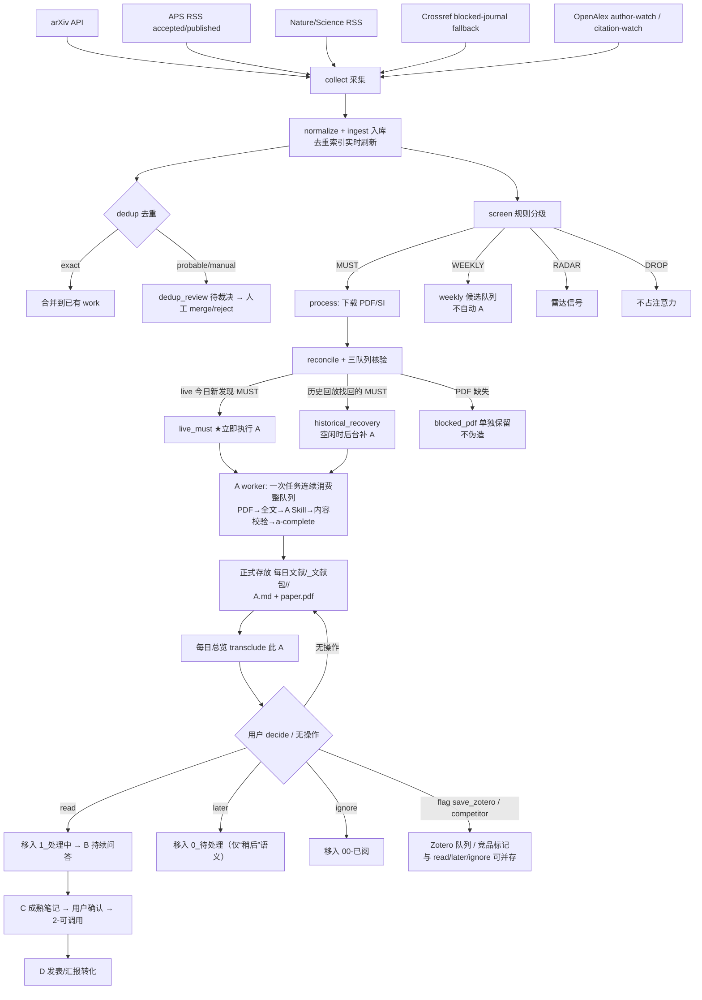

# 完整流程与当前工作阶段定位

> workflow_schema_version: 4（当前唯一流程契约；docs/HANDOFF.md 与 state/PROJECT_STATE.json 同步显示）

> 自动状态来源：`state/PROJECT_STATE.json`。本文件是静态说明，数字会随运行变化，以 `python3 literature_agent.py handoff` 后为准。

## 一、系统定位

个人科研文献雷达：在进入 A/B/C/D 阅读系统**之前**，后台自动完成 发现 → 去重 → 分级 → 全文获取 → A 建档，只把真正值得占用注意力的论文送到你面前。

系统成功的标准：**用户每天需要处理的东西少，而且都值得看。**

前台与后台严格分离：

- 后台自动：collect → dedup → screen → PDF/SI → A job 准备（live MUST 优先，historical 空闲补）→ digest；A 的生成由 Codex/ChatGPT executor 完成（`a-job` 只是生成任务清单，不等于已执行 A）。
- 自动完成的 A 正式存放：`Literatures/每日文献/_文献包/<work_id>/`（A.md + paper.pdf），不再投递 `0_待处理`。
- 前台只有：打开每日总览 → 勾选决定/标记/批注 → `sync-overview`（或 daily 自动同步）；`save_zotero`、`competitor` 是可叠加标签。
- `0_待处理` 只表示用户明确选择“稍后”的论文；`1_处理中`=read；`00-已阅`=ignore。

两条轴绝不可混用：

| 轴 | 取值 | 谁决定 | 用途 |
|---|---|---|---|
| 推荐优先级 | MUST / WEEKLY / RADAR / DROP | 机器（规则+信号） | 是否获取全文、执行 A、进周读或忽略 |
| 阅读阶段 | A / B / C / D | 用户 | 快速建档 / 处理中问答 / 成熟可调用 / 发表转化 |

## 二、全流程图



## 三、三个队列与 A worker 协议

| 队列 | 内容 | A 是否自动 |
|---|---|---|
| live_must | 今天新发现的 MUST | 立即进入 A 队列（最高优先，计入今日 MUST 数）；由 executor 完成 A |
| historical_recovery | 历史 replay 找回的重要论文 | 空闲时补 A 队列；不计入今日 MUST、不阻塞 live |
| weekly | 本周候选 | 不自动执行 A（除非以后升级） |

A worker 协议（`la_aworker.py` + `a_jobs/`）：

1. `python3 literature_agent.py a-job [--kind all]` 只生成一次任务清单（job 文件），**不等于已执行 A**；Codex/ChatGPT executor 消费该清单逐篇完成。
2. 一次任务逐篇消费整个队列：PDF/SI 验证 → 读取全文 → 按 A Skill 生成完整 A → 内容校验 → `a-complete` → 发布到 `每日文献/_文献包/<work_id>/`（A.md + paper.pdf，不投递 `0_待处理`）。
3. 不逐篇等待用户确认；模板不算完成；PDF 无法读取 / SI 缺失如实标注，不伪造。
4. `a-job-status` 查看逐篇进度。

## 四、决定与标签（分离）

- disposition（互斥，只选一个）：`python3 literature_agent.py decide <work_id> read|later|ignore`
- flags（可与 disposition 同时存在）：`python3 literature_agent.py flag <work_id> save_zotero|competitor [--unset]`
- 例如同一篇论文可以同时是 `read` + `save_zotero` + `competitor`。

## 五、Obsidian 每日文献总览（用户唯一日常前台）

- 位置：vault `Literatures/每日文献/YYYY-MM-DD 文献总览.md`（直接位于 每日文献/ 根目录，无日期子层）。
- 每天由 `daily` 自动生成/刷新；也可手动 `python3 literature_agent.py overview [--date YYYY-MM-DD]`。
- 内容：今日新文献（live）与历史补回（historical）分开；每篇含一句话推荐、项目、来源、
  决定勾选（要读/稍后/拒绝）、附加标记（ChatGPT 深读/ChatGPT 做 A/竞品/存 Zotero）、批注、
  方向反馈、A 建档 transclusion（`![[orange/Literatures/每日文献/_文献包/<work_id>/A.md]]`，不产生第二份 A）。
- rerun 保护：`<!-- LA:USER_BEGIN/END -->` 内用户内容原样保留；只刷新机器字段。
- 同步：`python3 literature_agent.py sync-overview [--date]`（或由 daily 自动同步）：
  - 无操作 → A 留在 `_文献包`；要读 → read（移入 1_处理中）；稍后 → later（移入 0_待处理）；
    拒绝 → ignore（移入 00-已阅）；同时勾选多个 = 冲突，不执行并报告。
  - ChatGPT 深读（需同时勾选要读）→ 生成 `_ChatGPT交接/日期/<论文>/`（paper.pdf/supplement/A.md/CONTEXT.md）。
  - ChatGPT 做 A → 生成 `_ChatGPT交接/日期/<论文>/`（paper.pdf/SI/CONTEXT.md/A_REQUEST.md，无正式 A）。
  - 竞品 → 现有 competitor flag；存 Zotero → 本地 Zotero queue（不直接写 Zotero）。
  - 方向反馈 → 只进 `direction_feedback_candidates.md`（pending_confirmation），不改 research_profile。
- 批注可回溯：`overview_syncs` 表记录 work_id/overview_date/disposition/flags/批注/方向反馈/synced_at。
- 迁移：`migrate_inbox_to_package()` 把已完成 A 的旧 `0_待处理` 笔记迁入 `_文献包/<work_id>/A.md`
  （只处理数据库确认的自动生成项，不覆盖文件，保留批注，更新 artifacts）。

## 六、daily 内容（v4 用户向）

daily/ 下的 v4 简报仍保留四个用户向小节，不暴露后台工程状态：

1. 今天必须知道（live MUST）
2. 已完成 A、等你决定（每条附 `decide` / `flag` 命令）
3. 竞品提醒（如有）
4. 本周候选（最多几篇）

后台统计（live backlog、A 完成率、blocked PDF、Inbox backlog 等）只进 `docs/HANDOFF.md` / `state/PROJECT_STATE.json`。
日常阅读以 每日文献/ 总览为准，`reports/daily/` 目录属于工程产物。

## 七、核心指标（不再以抓取量 / 库大小为核心）

- 今日 live MUST 数 与 live MUST → A 完成率
- A 平均完成时间
- blocked PDF 数
- 用户 accept/read 比例 与 ignore 比例
- historical backlog
- 用户 Inbox backlog

## 八、当前状态快照（2026-08-10 12:37 刷新，来源 state/PROJECT_STATE.json）

| 指标 | 值 |
|---|---|
| works | 6441（历史回放 4425，无损；数字随 daily 增长） |
| live MUST | 总数 2｜A 完成 2｜backlog 0 |
| A 工作流 | 已完成 13｜排队 0｜PDF 阻塞 1 |
| historical recovery | 总数 12｜完成 11｜backlog 0 |
| weekly 候选 | 29（不自动 A） |
| Obsidian 笔记 | 文献包 11（未决定）｜processing 2（read）｜inbox 1（旧人工笔记）｜callable 7 |
| 用户已决定 | 2（全部 read → 1_处理中）；等待决定 11 |
| 最近运行 | daily --force / ok / 20260810-1235 |

## 九、一次完整日常循环（命令序列）

```bash
python3 literature_agent.py daily            # collect → screen → process → A 队列 → digest → zotero → handoff
python3 literature_agent.py a-queue          # 看三队列 pending 与 blocked_pdf
python3 literature_agent.py a-job --kind all # 生成 A worker 任务清单（一次消费整队列）
python3 literature_agent.py a-job-status     # 逐篇 A 进度
python3 literature_agent.py decide <id> read|later|ignore   # 用户唯一需要做的决定
python3 literature_agent.py flag <id> save_zotero|competitor [--unset]
python3 literature_agent.py zotero-export   # 生成 zotero_export.bib，拖入 Zotero 即自动建档
python3 literature_agent.py handoff          # 刷新接手状态
```

## 十、A/B/C/D 衔接契约

1. A：只基于实际取得的正文/SI 生成完整建档；完成后发布到 `每日文献/_文献包/<work_id>/`（不投递 `0_待处理`），不得把模板当完成。
2. 用户决定 `read`：笔记进入 `1_处理中`，随后可围绕原文持续问答；B 只追加本轮新增讨论总结。
3. C：融合 A 与历次 B，形成成熟笔记；只有用户明确确认后才移动到 `2-可调用`。
4. D：从成熟 C 派生论文、汇报或公开内容；不得反向改写 C 的事实底稿。
5. `later` 留在 `0_待处理`；`ignore` 移到 `00-已阅`；竞品和 Zotero 是独立标签/动作。

## 十一、可靠性约束

- 同批次 arXiv/DOI 会实时刷新去重索引；arXiv 版本号保留并检测更新。
- PDF 必须是有效 `%PDF-` 且达到最小体积；HTML challenge 不得冒充全文，失败可重试。
- coverage 同时报告 observed recall 与 inferred discoverability，不能把"理论可发现"写成"已发现"。
- Obsidian 投递和移动不覆盖已有文件；A/B/C/D 阶段移动遵守用户明确决定。

## 十二、定时运行与自动补课（2026-08-10 起）

- 调度：macOS launchd（`automation/install_launchagent.sh`），每天 **07:00 / 08:00 / 09:00 / 10:00** 各跑一次 `literature_agent.py daily`，一次完成 collect → dedup → screen → process → A 队列 → digest → 总览 → zotero-export。
- 批注近实时同步：`automation/install_sync_agent.sh` 安装第二个 launchd agent，**每 60 秒**跑 `sync-overview --all`（纯本地读文件 + DB，无网络、无模型调用），勾选后约 1 分钟内自动生效。
- 当天守卫：当天已成功（ok/partial）跑过一次后，后续时间点自动跳过重活，只做轻量批注同步（`sync_old_overviews`）；失败则由下一个时间点自动重试。手动 `daily --force` 可强制重跑。
- 重要：两个 agent 都必须用 `/Library/Frameworks/Python.framework/Versions/3.12/bin/python3`（不能用 `/usr/bin/python3`——CLT 二进制在 launchd 下被 macOS TCC 拦截，无法读取 Desktop 目录；2026-08-10 已实测修复）。
- 错过点：电脑睡眠/关机错过的时间点，launchd 在唤醒后补跑错过的任务；7/8/9/10 四档进一步降低全天无运行的概率。
- 自动补课（`run_daily` 内置，幂等）：距上次成功 daily 超过 1 天，把 arXiv/Crossref/OpenAlex 窗口拉大到 `gap+1` 天；超过 7 天先跑 `historical-replay`（覆盖缺口的 arXiv/Crossref/OpenAlex 历史）再正常收集。
- Nature 系缺口（2026-08-10 已解决）：Nature Communications / Nature Materials / Nature Nanotechnology 已并入现有 Crossref 期刊回补（`journal_identifiers.json` 的 backfill 角色，Nat Comm rows=400），日常与补课窗口都按日期回补，DOI 去重不与 RSS 重复。
- Zotero 一键导入：勾选“存 Zotero”→ 本地队列 accepted。
  - 半自动（默认）：`zotero-export`（或 daily 自动刷新）生成 `data/queues/zotero_export.bib`，把该文件拖进 Zotero 即自动建档（DOI/arXiv 链接自动抓取元数据）。
  - 全自动（可选）：`config/local.json` 配置 `zotero.api_key` / `zotero.user_id` / `auto_sync: true` 后，勾选存 Zotero 或运行 `zotero-sync` 会通过 Zotero Web API 自动创建条目 + 上传 PDF + 归类 + 打标签，无需任何手动步骤；失败自动回落到 .bib 兜底。
  - Zotero API key 获取：https://www.zotero.org/settings/keys → Create new private key（勾选允许读写用户资料库）；user_id 在同页顶部显示。
