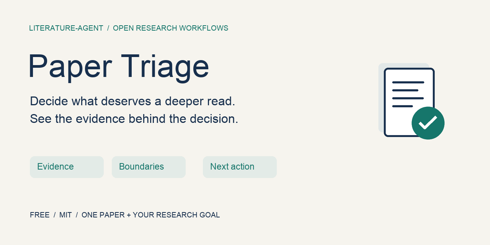

# Paper Triage



**Decide what deserves a deeper read. See the evidence behind the decision.**

An open-source agent skill by Jiaqi Xin, extracted from [literature-agent](../../README.md)'s personal research workflow.

Give your agent **one scientific paper + your research goal**. Receive a concise reading decision with the contribution, evidence locations, boundaries, relevance and one next action.

**Free · MIT · No new API keys required by the skill · No hosted service**

## Try it without installing anything

1. Download or open [`SKILL.md`](../../skills/paper-triage/SKILL.md).
2. Give it to an agent that can read your paper. Attach a lawfully obtained PDF, or provide readable full text.
3. Add your research goal and the request below. If your agent cannot open a file, paste the instructions and readable paper text instead.

```text
Follow the attached paper-triage SKILL.md to assess this paper.
My research goal: understand symmetry criteria for altermagnetic band splitting.
Tell me which evidence supports the contribution, what remains uncertain,
and what I should read next. Answer in English.
```

中文也可以：

```text
请按附带的 paper-triage SKILL.md 评估这篇论文。
我的研究目标：理解交错磁中非相对论自旋劈裂的对称性判据。
请用中文说明关键证据、结论边界、研究相关性和下一步阅读动作。
```

The skill is free. Your existing agent's subscription or model usage costs still apply. It does not add a model endpoint, telemetry or an upload service; your host agent's data handling still applies.

## What you get

| Section | Question answered |
| --- | --- |
| Paper and reading basis | Which paper/version and which materials were actually read? |
| Core idea and research object | What is the central work? |
| Prior problem and contribution | What gap do the authors address? |
| Evidence and boundaries | Which figures, equations or passages support it, and under what limits? |
| Relevance and possible use | How does it connect to your stated goal? |
| Priority and next action | MUST / WEEKLY / RADAR / DROP, why, and what to inspect next? |

Missing full text yields a provisional assessment. Missing supplements stay unverified. A recommendation never moves or overwrites your notes.

## Real-paper examples

These are concise, curated authoring-run examples produced in Codex, checked against the linked source passages. They demonstrate the report format; they are not independent benchmarks or user testimonials.

- [Theory: altermagnetic symmetry classification](examples/theory.md) — PDF main text and two rendered figure pages inspected; embedded supplement not audited.
- [Experiment: anomalous Hall response in MnTe](examples/experiment.md) — readable HTML main text and Figure 7 inspected; PDF retrieval timed out and separate supplement was not read.
- [Validation record and reproducible requests](VALIDATION.md) — what was checked, observed failures and what remains untested.

## Local skill setup in Codex

For repo-local discovery, copy the `skills/paper-triage` folder into `.agents/skills/` in the repository where you read papers. Do not overwrite an existing skill folder. Then invoke `$paper-triage` with a paper and your goal. [Official local skill documentation](https://developers.openai.com/codex/skills#where-to-save-skills).

This repository includes a repo-local discovery symlink to the source folder. Explicitly asking Codex to read the file also works without installation. The recorded examples used explicit file loading in this authoring chat; automatic discovery and fresh-session installation have not been behaviorally tested.

For other agents, use the attach/read-file method above or their documented skill installation flow. No broad cross-agent compatibility claim is made.

## Scope and feedback

Initial examples cover physics/materials research. The skill helps you assess a paper's argument; it does not certify scientific validity, independently establish novelty, or replace reading the source. It does not run the full literature radar, access institutional subscriptions, synchronize Zotero, or produce a systematic review.

Feedback is most useful with the paper/version, research goal, host agent, problematic claim and the supporting source location. Use the repository's [issues](https://github.com/Xin-Jiaqi/literature-agent/issues). Share only public or redacted material; do not post private manuscripts or full chat logs containing unpublished work. Maintenance is best effort alongside research.

## Build the submission ZIP

From the repository root:

```bash
python3 scripts/package_paper_triage.py
```

The ZIP contains only `SKILL.md` and the MIT license. PDFs, private notes, configuration, examples and evaluation downloads are excluded. Documentation and examples remain linked from GitHub. Agensi submission is a separate step and requires a signed-in creator account.

The packager refuses to replace an existing file. For another build, choose a new path with `--output /path/to/new-package.zip`.
